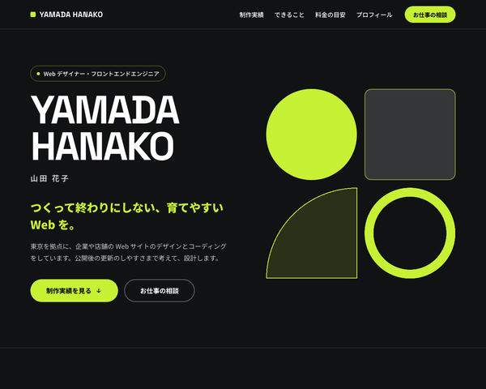

# BcLpPortfolioTheme

baserCMS5用の、フリーランス・個人事業主の自己紹介と、お仕事の依頼・相談の受付のための1ページ LP（ランディングページ）テーマです。
制作実績・できること・制作の流れ・料金の目安・お客さまの声・プロフィール・相談フォームまでを、
BurgerEditor のブロック操作と管理画面の設定だけで編集できます。

## 主な機能

- **1ページ LP**：トップの固定ページ1枚に、セクションを BurgerEditor のブロックで並べる構成
  - ヒーロー（代表作の画像）／制作実績／できること／制作の流れ／料金の目安／お客さまの声／プロフィール／よくある質問／お仕事の相談（CTA）
  - セクションの追加・削除・並べ替えは、ブロック操作だけでできる
- **濃い地に明るいアクセント**：地はサブ（濃い色）、ボタンや英字はメイン（明るい色）。サブを明るい色にすると、文字は自動で黒になる
- **ページ内ナビの自動生成**：大見出しブロックの「ID設定」に英字（例 `works`）を入れると、ヘッダーのナビに載る。
  見出しの上には ID から作った大きな英字（`WORKS`）が出る
- **お仕事の依頼・相談フォーム**：入力 → 確認 → 完了の3画面。ご依頼の内容（複数選択）・ご予算・希望の納期（カレンダー）など。項目は管理画面のメールフィールドで追加・並べ替えできる
- **テーマ設定の4色**で全体の配色が変わる（メイン／サブ／リンク／ホバー）。ロゴもテーマ設定で変更できる
- **初期データ**：見本サイト一式（`default`）と、最小構成（`empty`）
- レスポンシブ（PC／スマホ）、`prefers-reduced-motion` 対応

## 動作環境

- baserCMS5.4以上
- BurgerEditor（BcBurgerEditor）プラグインが有効であること

## インストール

1. `plugins/BcLpPortfolioTheme` に配置
2. 管理画面 > プラグイン管理 で BcBurgerEditor が有効になっていることを確認
3. 管理画面 > テーマ管理 で BcLpPortfolioTheme を適用
4. 同じ画面で初期データ `default`（見本サイト）または `empty`（最小構成）を読み込む

> 初期データを読み込むと、ユーザー以外のデータ（固定ページ・メールフォーム・サイト基本設定など）は初期化されます。
> 運用中のサイトでは読み込まないでください。

## 使い方

### 編集できる場所

| 内容 | 編集する場所 |
|---|---|
| 本文（全セクション） | 固定ページ「トップページ」の BurgerEditor |
| ロゴ・配色 | テーマ設定（ロゴの画像がないときは、ロゴの代替テキストを文字で出す） |
| ヘッダーのナビ | 本文の大見出しブロックの「ID設定」（自動で作られる） |
| ヘッダーの「お仕事の相談」ボタンのリンク先 | 自動（公開中の最初のメールフォーム） |
| フォームの説明文・完了メッセージ・項目 | メールフォームの設定・メールフィールド |
| フッター（名前・SNS） | ウィジェットエリア「フッター」のテキストウィジェット |

### 本文ブロックの独自 class

ブロック設定の「独自class設定」に入れると、決まった見た目になります。
一覧と中身の書き方は `webroot/css/bge_style.css` の冒頭にあります。

| 独自 class | 使うブロック | 見た目 |
|---|---|---|
| `pf-blk--hero` | 画像右寄せ（テキスト回り込み無し） | ヒーロー（肩書き・英字の名前・名前・キャッチ・紹介文・ボタン2つ。画像は代表作で、キャプションに作品名。画像が空なら円・四角・四分円・輪の図形） |
| `pf-blk--section` | 大見出し | セクション見出し（ID 設定でナビと大きな英字） |
| `pf-blk--nonav` | 大見出し（`pf-blk--section` と併用） | ナビに載せない |
| `pf-blk--works` | 画像3列＋テキスト | 制作実績（作品名・担当）。6件なら同じブロックを2つ並べる |
| `pf-blk--services` | 1カラムテキスト | できること（箇条書き → アイコン付きのカード） |
| `pf-blk--steps` | 1カラムテキスト | 制作の流れ（番号付きリスト → 番号の大きなカード） |
| `pf-blk--price` | 1カラムテキスト | 料金の目安の表（CKEditor の表。料金の列は英字の太字） |
| `pf-blk--note` | 1カラムテキスト | 表の下の小さな注記 |
| `pf-blk--voices` | 画像3列＋テキスト | お客さまの声（画像は使わない。声と、お客さまの名前・業種のタグ） |
| `pf-blk--profile` | 画像左寄せ（テキスト回り込み無し） | プロフィール（写真・名前・肩書き・経歴・使えるツール・SNS） |
| `pf-blk--faq` | 1カラムテキスト | よくある質問（すべて開いた状態） |
| `pf-blk--cta` | 1カラムテキスト | お仕事の相談の CTA（メイン色の角丸の箱） |
| `pf-blk--center` | 任意 | 中央寄せ |

ブロック設定の「背景色」は、テーマ色に置き換えています（ブルー＝地より少し明るい面／グレー＝さらに明るい面／ピンク＝メイン色）。

### 複数の場所に書かれている値を変えるとき

次の値は複数の場所に書かれているので、それぞれ直してください。

- **名前**：ヒーロー／プロフィール／フッター（ウィジェット）／メールフォームの差出人名・件名／テーマ設定のロゴの代替テキスト（ヘッダーのロゴとコピーライトに使う）
- **SNS のリンク**：プロフィール／フッター（ウィジェット）
- **料金**：料金の目安（`pf-blk--price`）／メールフィールド「ご予算」の選択肢
- **返信の目安（2営業日以内）**：お仕事の相談の CTA（`pf-blk--cta`）／メールフォームの説明文・送信完了メッセージ

### 配色の例

初期色は黒（サブ）とネオンのライム（メイン）です。テーマ設定の4色を変えると、次のような配色にできます。

| | 初期色（ライム） | 配色例（シアン） | 配色例（オレンジ） |
|---|---|---|---|
| メイン | `#c6f135` | `#3ee6e6` | `#ff8a3d` |
| サブ | `#111214` | `#0d1420` | `#16120f` |
| リンク | `#c6f135` | `#3ee6e6` | `#ff8a3d` |
| ホバー | `#e3ff7a` | `#9af5f5` | `#ffb27a` |

メインは明るい色（ボタンの文字は自動で黒になる）、サブは濃い色にしてください。

## 制限事項

- 名前・SNS などは各ブロックに直接書くため、変更時は複数の場所を直す必要があります（上記「複数の場所に書かれている値を変えるとき」）
- 制作実績の詳細ページはありません（画像にリンクを付けると、作品のサイトなどへ移動できます）
- フォーム画面の見出しの上の英字「Contact」は、テンプレート（`templates/plugin/BcMail/Mail/default/*.php`）に書いています

## 同梱物・外部リソース

| 名前 | 用途 | ライセンス |
|---|---|---|
| [jQuery](https://jquery.com/) 3.7.1（`webroot/js/vendor/`） | BurgerEditor の公開側スクリプト（YouTube・画像ポップアップ）と、日付のカレンダーの動作に必要 | MIT |
| jQuery UI 1.11.4 | 日付のカレンダー（baserCMS の bc-front に同梱のものを読み込む。このテーマには同梱していない） | MIT |
| [Google Fonts](https://fonts.google.com/)（Noto Sans JP・Space Grotesk） | 本文・英字のフォント（CDN から読み込み。同梱はしていない） | SIL Open Font License 1.1 |
| アイコン（`bge_style.css`・テンプレート内の SVG） | できること・引用符・矢印・時計・完了のアイコン | [Lucide](https://lucide.dev/) のアイコンをもとにしている（ISC License） |

## ライセンス

MIT License
